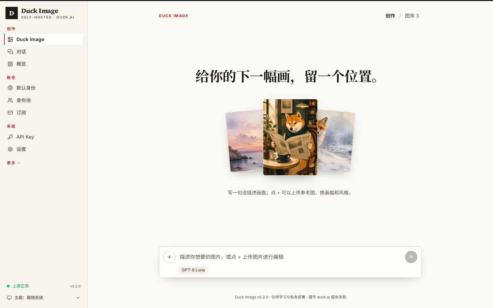
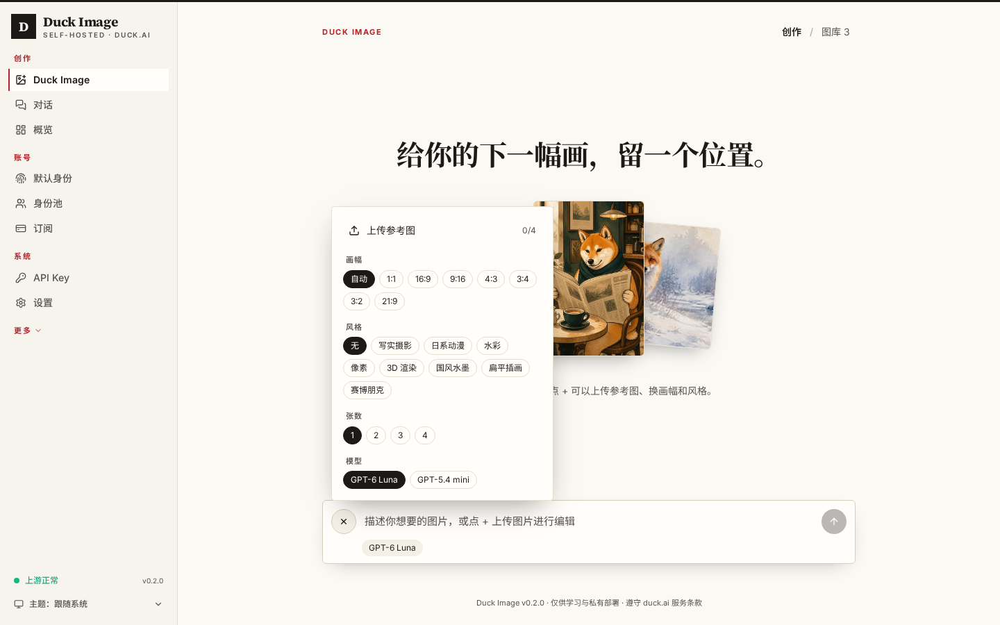
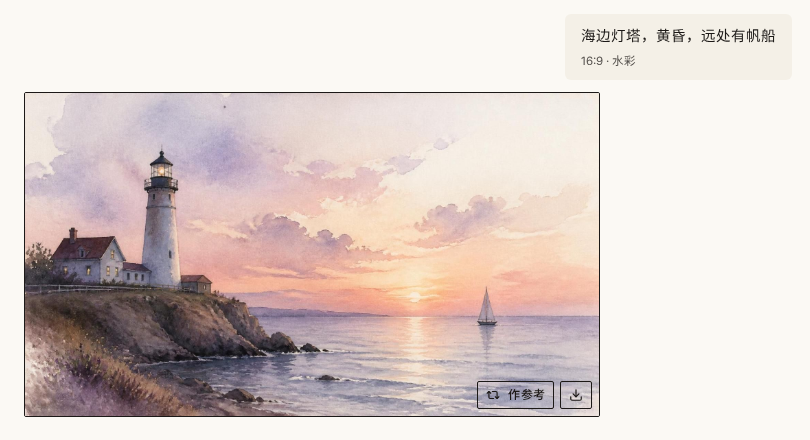
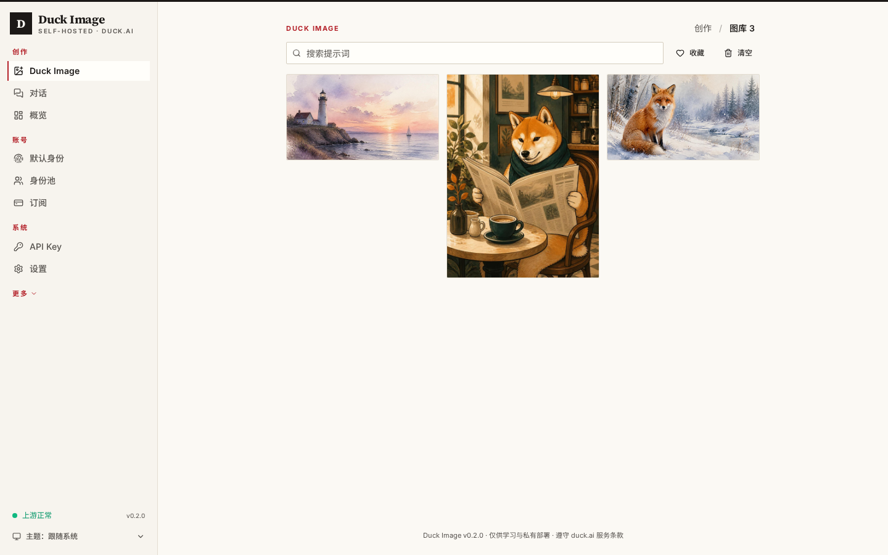
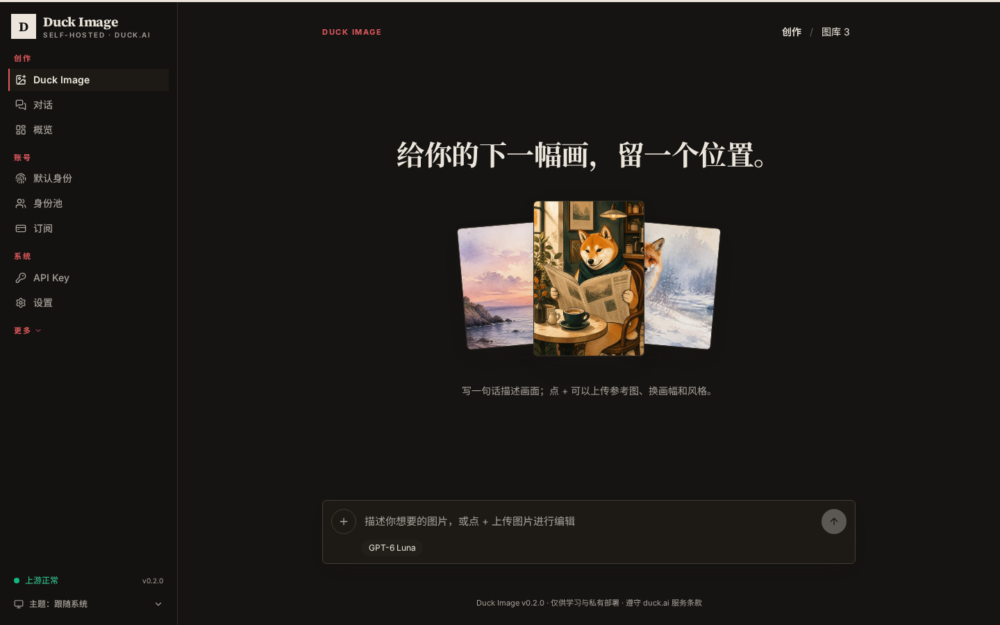

# Duck Image

**自托管的 duck.ai 生图与对话网关。** 打开网页，写一句话就出图；也能当 OpenAI 兼容 API 给别的客户端用。

[](https://github.com/Sakuralaaa/duck-image/actions/workflows/ci.yml)
[](https://github.com/Sakuralaaa/duck-image/pkgs/container/duck-image)
[](LICENSE)



---

## 能做什么

- **一句话生图**：输入框写描述，回车出图。点 **+** 可以上传参考图（最多 4 张）、选画幅、一次出 1–4 张。风格直接写在描述里。
- **参考图改图**：上传或粘贴一张图，说怎么改就行；生成结果也能一键「作参考」继续改。
- **图库**：每张图自动保存，可搜索、收藏、下载、删除；收藏的图不会被自动清理。
- **联网搜索对话**：「对话」页默认开启联网搜索，回答带来源链接。
- **OpenAI 兼容 API**：`/v1/images/generations`、`/v1/images/edits`、`/v1/chat/completions`（支持 `web_search`）、`/v1/models`。
- **安静的界面**：杂志风排版，浅色 / 深色两套。一切正常时不打扰你；出错时状态点变红，点一下就是日志。

| 选项都收在 + 里 | 出图 |
| --- | --- |
|  |  |

| 图库 | 深色 |
| --- | --- |
|  |  |

---

## 部署

镜像：`ghcr.io/sakuralaaa/duck-image:latest`（Alpine + 单文件二进制，`linux/amd64` 与 `linux/arm64`，内置中文字体）。

```yaml
# compose.yml
services:
  duck-image:
    image: ghcr.io/sakuralaaa/duck-image:latest
    container_name: duck-image
    restart: unless-stopped
    ports:
      - "8787:8787"
    environment:
      DUCK_IMAGE_ADMIN_TOKEN: "换成你自己的长随机串"
    volumes:
      - duck-image-data:/data   # 配置、数据库、图库都在这里
volumes:
  duck-image-data:
```

```bash
docker compose up -d
```

打开 `http://<服务器>:8787/admin/`，用 `DUCK_IMAGE_ADMIN_TOKEN` 登录。没设的话首次启动会自动生成，`docker compose logs duck-image` 里能看到；默认 API Key 在「API Key」页。

在 Atoll 里部署：新建应用，镜像填 `ghcr.io/sakuralaaa/duck-image:latest`，端口 `8787`，挂载 `/data`，环境变量加 `DUCK_IMAGE_ADMIN_TOKEN`。

### 常用环境变量

| 变量 | 作用 | 默认 |
| --- | --- | --- |
| `DUCK_IMAGE_ADMIN_TOKEN` | 管理台登录口令 | 首次启动自动生成 |
| `DUCK_IMAGE_PORT` | 监听端口 | `8787` |
| `DUCK_IMAGE_HOST` | 监听地址 | `0.0.0.0`（镜像内） |
| `DUCK_IMAGE_DATA_DIR` | 数据目录 | `/data`（镜像内） |

旧的 `DUCKAI_CPA_*` 变量名仍然有效。

---

## API 示例

```bash
# 文生图（size 会换算成画幅提示）
curl http://127.0.0.1:8787/v1/images/generations \
  -H "Authorization: Bearer $KEY" -H "Content-Type: application/json" \
  -d '{"prompt":"黄昏海边的灯塔，水彩","size":"1792x1024","n":1}'

# 参考图改图（OpenAI multipart 形态）
curl http://127.0.0.1:8787/v1/images/edits -H "Authorization: Bearer $KEY" \
  -F prompt="把背景换成星空" -F "image[]=@cat.png"

# 联网搜索对话
curl http://127.0.0.1:8787/v1/chat/completions \
  -H "Authorization: Bearer $KEY" -H "Content-Type: application/json" \
  -d '{"model":"gpt-6-luna","web_search":true,"messages":[{"role":"user","content":"今天东京天气怎么样？"}]}'
```

**关于参数**：duck.ai 网页端的生图（Create Image，结果标注 GPT Image 2.5）只接受「提示词 + 参考图」，没有尺寸、张数、风格、质量这些开关，一次一张。所以 Duck Image 把画幅写进提示词（尽力而为，不是原生尺寸），`n>1` 是顺序多次生成；中途失败会返回已生成的部分并标记 `partial`。

---

## 开发

```bash
npm ci
npm run build:web   # 构建管理台
npm test            # 需要 Node 24
npm start
```

推送 `v*` tag 会自动构建并发布多架构镜像。更多技术细节（协议、身份池、订阅、长对话压缩等）见 [docs/UPSTREAM-README.md](docs/UPSTREAM-README.md) 和 [docs/](docs/)。

---

## 声明

本项目仅供个人学习与私有部署。使用前请阅读 [Duck.ai 服务条款](https://duckduckgo.com/duckai/privacy-terms)：条款禁止绕过限流 / 安全措施、自动化查询以及基于 Duck.ai 对外提供 AI 服务。请勿公开提供或转售，风险自负。

## 致谢

Duck Image 基于 [LandmineHQ/duckai-cpa](https://github.com/LandmineHQ/duckai-cpa) 改造而来。duck.ai 协议对接、挑战求解、身份池、订阅、SSE 流式、管理台骨架等核心工作都来自上游，感谢 LandmineHQ 和所有贡献者的开源。Duck Image 在此基础上重做了生图体验、图库和界面。

## License

[MIT](LICENSE)
